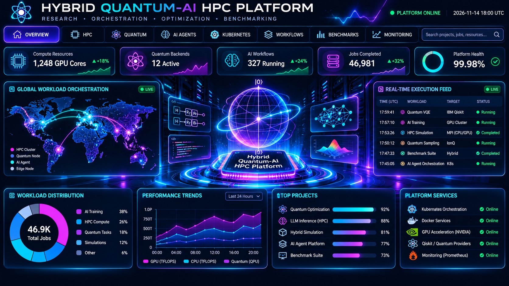

# Hybrid Quantum–AI HPC Engineering Platform

<div align="center">

## 🚀 LIVE HPC PLATFORM

### [▶ LAUNCH THE HPC DASHBOARD](https://hybrid-quantum-ai-hpc-platform-tamas-quantum-lab.vercel.app)

[](https://hybrid-quantum-ai-hpc-platform-tamas-quantum-lab.vercel.app)

**CPU computing · Quantum simulation · AI orchestration**

Open registration is available. Each account sees only its own jobs and benchmark history.

[](https://hybrid-quantum-ai-hpc-platform-tamas-quantum-lab.vercel.app)

*Click the image or the launch button to open the platform. Concept visualization — illustrative metrics, not measured benchmark results.*

</div>

[](https://github.com/Tamas22-cell/hybrid-quantum-ai-hpc-platform/actions/workflows/ci.yml)

Research platform for CPU, GPU and quantum workload orchestration.

## Project links

- [Open the public GitHub repository](https://github.com/Tamas22-cell/hybrid-quantum-ai-hpc-platform)
- [Open the deployed HPC dashboard](https://hybrid-quantum-ai-hpc-platform-tamas-quantum-lab.vercel.app) *(public registration and login)*
- [Read the V12 research release](https://github.com/Tamas22-cell/hybrid-quantum-ai-hpc-platform/releases/tag/v12.0.0-rc.1)

The README is the public project overview. It links to the source, implementation notes, cloud validation and limitations.

### Cloud validation — November 15, 2026

- CPU NumPy, 256 × 256 matrix: 0.735 ms median compute latency, 45.634 GFLOPS.
- Qiskit GHZ simulator, 4 qubits: 0.241 ms median compute latency, fidelity approximately 1.
- Dashboard submission, polling, persisted history, performance comparison and both export download dialogs verified in the live browser.
- Docker API integration, security checks and four export serialization tests passed in CI.

These are individual cloud benchmark results, not a CPU-versus-quantum speedup comparison. Physical QPU, cloud GPU and multi-node execution remain unvalidated. Exported local file contents were not independently inspected.

## V1.0 CPU baseline
NumPy and MPI matrix multiplication with seeded inputs, reference validation, median latency, estimated GFLOPS, MPI speedup and efficiency.

On Linux with Open MPI installed:
```bash
pip install -r requirements-dev.txt
python -m pytest -v
python -m cpu_engine --size 256 --repeats 5
python benchmarks/mpi_scaling.py
```

MPI timings include scatter, broadcast and gather; they exclude input generation and reference validation. Speedup compares one MPI rank with two ranks under a single-thread BLAS limit. Small workloads may slow down. CI artifacts contain measured results, not hardware-independent performance claims.

## Roadmap
V1 CPU; V2 GPU; V3 quantum; V4 hybrid algorithms; V5 distributed computing; V6 AI orchestration; V7 compiler and error correction; V8 benchmarking; V9 cloud; V10 dashboard; V11 security and monitoring; V12 validated release.

Current status: V12 cloud research release candidate. CPU and Qiskit workloads have persisted cloud results; physical QPU, cloud GPU and multi-node validation remain open.

## V2.0 — GPU acceleration
PyTorch CUDA and optional CuPy float64 matrix multiplication; synchronized compute-only timings exclude host/device transfers. CPU reference validates numerical accuracy. Install requirements-gpu.txt with a CUDA-enabled PyTorch build or requirements-cupy.txt with a compatible CUDA 12 runtime. Run `python -m benchmarks.cpu_gpu --backend torch` on a GPU host. CPU CI exercises PyTorch CPU only; CUDA tests skip without hardware. No GPU speedup claimed until measured.

## V3.0 — Quantum simulation
Independent Qiskit and CUDA-Q GHZ statevector benchmarks. CUDA-Q uses the CPU simulator (`qpp-cpu`); measurements report fidelity, normalization and median execution latency. Install requirements-quantum.txt or requirements-cudaq.txt and run `python -m benchmarks.quantum --backend qiskit` (or `cudaq`). No physical QPU execution is claimed.

## V4.0 — Hybrid algorithms
PennyLane VQE compared to exact diagonalization, Qiskit QAOA on a synthetic four-asset portfolio compared to exhaustive enumeration, and PennyLane/PyTorch QML training compared to a classical cosine baseline. These are small simulator experiments, not investment advice or quantum advantage claims.

## V5.0 — Distributed computing
Ray local multi-process task scheduling complements MPI. Matrix rows are partitioned across tasks, with a shared operand in the object store. Benchmark one versus two CPU slots using `python -m benchmarks.distributed` after installing requirements-distributed.txt. Timings include dispatch and result collection, excluding startup and initial object placement. Multi-node validation remains pending.

## V6.0 — Backend orchestrator
Rule-based scheduling selects CPU, CUDA or Ray for matrix tasks and a quantum simulator for circuits. GPU/Ray capability flags are supplied by callers; runtime failures trigger ordered fallback and structured attempt records. Thresholds are initial heuristics, not learned or cost-calibrated policies. Physical QPU selection and learned scheduling remain future work.

## V7.0 — Compiler and error control
Qiskit level-3 transpilation compares circuit depth, gate count and state fidelity. A calibrated symmetric single-bit readout model demonstrates mitigation, and a three-qubit repetition circuit corrects one injected bit flip. Run `python -m benchmarks.compiler`. This is not fault-tolerant quantum computing or hardware noise validation.

## V8.0 — Benchmark reporting
Run `python -m benchmarks.suite` for repeated CPU and Qiskit measurements, or add `--gpu` on a CUDA host. Reports include JSON/CSV, environment metadata, median latency, p95 of run medians, reciprocal compute latency and optional cost estimated from a user-supplied hourly rate. GPU speedup compares identical matrix workloads only. MPI and Ray scaling remain separate benchmarks. Costs exclude idle time, billing granularity and transfer overhead; p95 is not a confidence interval.

## V9.0 — Cloud infrastructure
Local development: set `HPC_API_KEY` and `POSTGRES_PASSWORD`, then run `docker compose up --build`. The API binds to localhost:8000; `/docs` exposes OpenAPI. Register through the frontend (which keeps the API key server-side), then submit a matrix or quantum job using the returned session cookie. RQ processes jobs through Redis and stores successful results in PostgreSQL. The container supports CPU and Qiskit simulation. Kubernetes API deployment requires a prebuilt image and external Redis; worker deployment and live cluster validation are pending. Keep the development API private.

## V10.0 — Control center
Next.js dashboard in `frontend/`. Run `npm install` and `npm run dev` there with `HPC_API_URL=http://localhost:8000` and `HPC_API_KEY` set in the server environment. Vercel root directory is `frontend`; configure both server-side variables to reach the backend and keep its registration/login endpoints private. The dashboard supports public registration, login, secure sessions, CPU and quantum simulator submissions, polling and measured metrics. GPU and physical QPU execution are not exposed by the current backend. Remote deployment uses HTTPS.

## V11.0 — Security and monitoring
Passwords are stored as salted scrypt hashes. Session tokens are opaque, stored only as hashes in Neon, and sent to the browser in `HttpOnly`, `Secure` (production), `SameSite=Lax` cookies with a seven-day expiry. Redis limits registration/login attempts by client and workload submissions per user. Every queued job carries its owner's ID; status and history endpoints enforce that owner. Legacy results without an owner are hidden from user accounts. Prometheus metrics are exposed at `/metrics`; keep backend service details private. Security CI runs Bandit, pip-audit and npm audit. Registration does not require a paid email service; email confirmation and password reset are not currently provided. Never publish secrets.

## V12.0 — Research release candidate
See [research protocol and validation gates](docs/RESEARCH_RELEASE.md) and [security guidance](SECURITY.md). Set `HPC_API_URL` and `HPC_API_KEY` on the Next.js server; set `HPC_API_KEY`, `DATABASE_URL` and `REDIS_URL` on the Render API, and `DATABASE_URL` plus `REDIS_URL` on the worker. The browser-facing Vercel deployment is public; account creation and session checks protect user workloads. Cloud deployment uses the existing Vercel, Render API and RQ worker, Redis and Neon PostgreSQL services. Local CUDA measurements are separate from cloud results. Physical QPU execution remains unvalidated. Release tag requires green CI on the final commit.

## Cloud architecture and validation

Browser → public Next.js login/registration → HttpOnly session cookie → FastAPI session validation → Redis/RQ → owner-tagged worker job → per-user PostgreSQL history. The dashboard reads up to 100 results for the signed-in user and exports CSV/JSON. Older unowned results are not exposed. System status checks API, Redis, PostgreSQL and worker registration; registration alone does not prove execution health. Performance summaries group measured workloads by backend and size. Cloud GPU/QPU and Ray multi-node execution remain optional research extensions.
